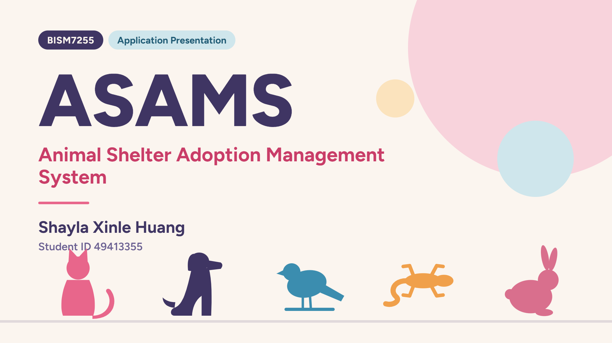
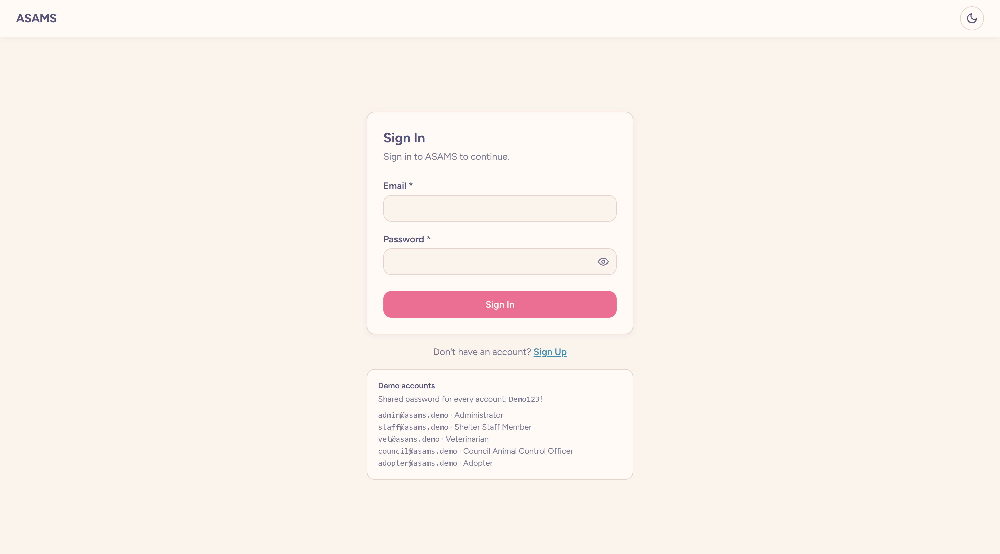
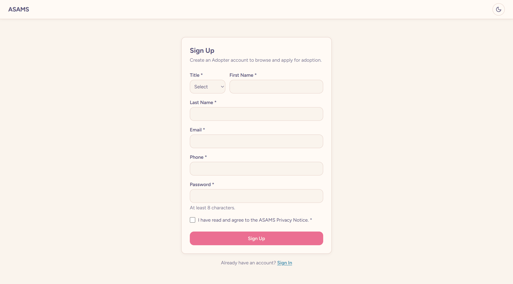
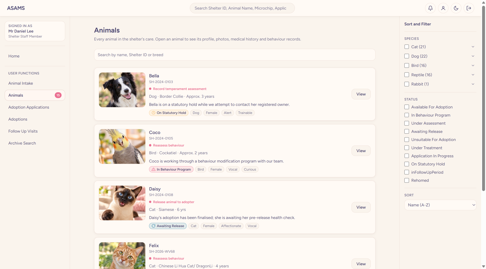
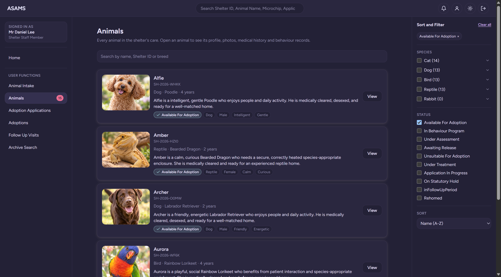
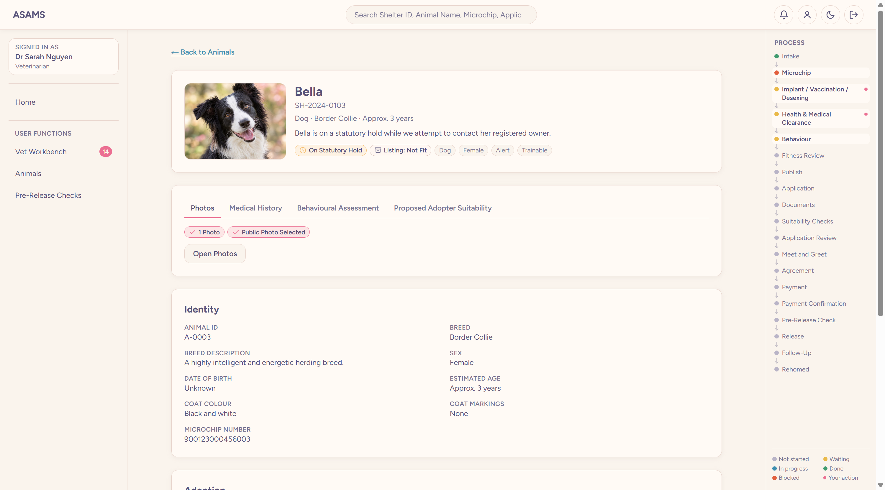
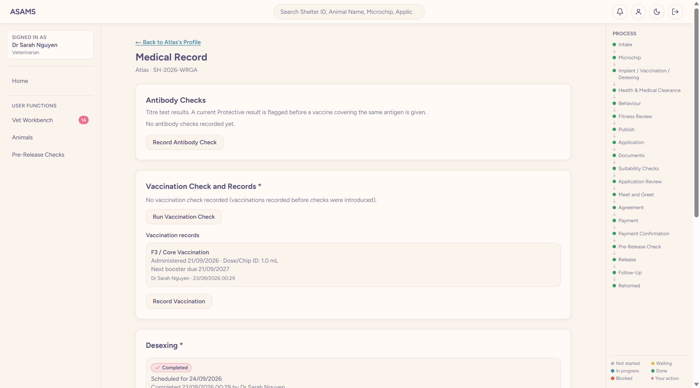
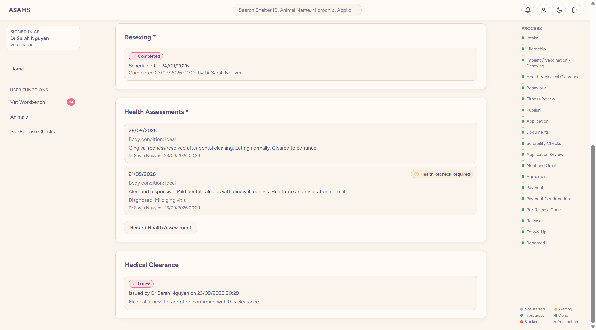

# Animal Shelter & Adoption App
BISM7255 Assignment 2 prototype.
## 📸 Screenshots

### Landing Page

  

### Sign In & Sign Up
<table>
  <tr>
    <td></td>
    <td></td>
  </tr>
  <tr>
    <td align="center">Sign In</td>
    <td align="center">Sign Up</td>
  </tr>
</table>

### Staff Dashboard (Light / Dark Mode)
<table>
  <tr>
    <td></td>
    <td></td>
  </tr>
  <tr>
    <td align="center">Light Mode</td>
    <td align="center">Dark Mode</td>
  </tr>
</table>

### Animal Profile

  

### Animal Health Records
<table>
  <tr>
    <td></td>
    <td></td>
  </tr>
</table>
